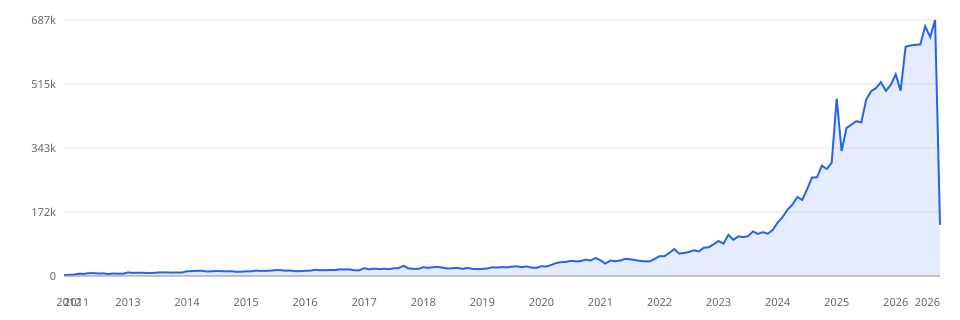
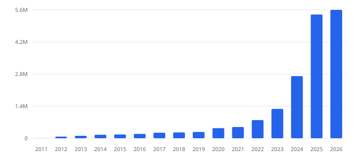
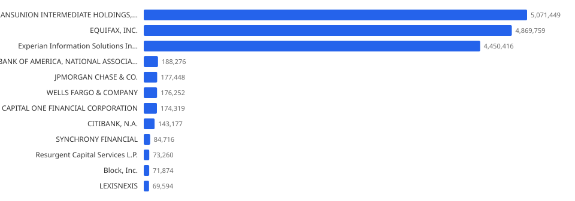

# CFPB Consumer Complaint Database — analysis

_Generated 2026-10-11 00:11:23 from `./data/complaints.db` (18,329,250 complaints, read-only)._

## Executive summary

- The database holds **18,329,250 complaints** received between **2011-12-01** and **2026-10-10** — 8,161 companies, 21 products, 178 issues and 309 sub-issues.
- Volume is extremely top-heavy: the **top 3 companies account for 78.5%** of all complaints and the top 10 for 84.1% (HHI ≈ 2,068; on the standard scale 1,500–2,500 is "moderately concentrated" and >2,500 "highly concentrated").
- **TRANSUNION INTERMEDIATE HOLDINGS, INC.** alone is the single largest filer at 5,071,449 complaints (27.7%).
- The single largest product is **Credit reporting or other personal consumer reports** with 12,724,402 complaints (69.4%).
- Complaint volume has grown sharply: **2024 → 2025** went from 2,734,268 to 5,442,951 (+99% YoY). The busiest month on record is **2026-09** with 686,618 complaints.
- Companies respond on time in **99.4%** of complaints where timeliness is recorded (110,895 late).
- The most common resolution is **Closed with explanation** (61.3%), and most complaints arrive via **Web** (96.5%).

## 1. Dataset at a glance

| Metric | Value |
| --- | ---: |
| Complaints | 18,329,250 |
| Date range | 2011-12-01 → 2026-10-10 |
| Distinct companies | 8,161 |
| Distinct products | 21 |
| Distinct sub-products | 121 |
| Distinct issues | 178 |
| Distinct sub-issues | 309 |
| Distinct states/territories | 63 |
| Top-3 company share | 78.5% |
| Top-10 company share | 84.1% |
| Company HHI (0–10,000) | 2,068 |

## 2. Volume over time

### Complaints by year

| Year | Complaints | Share | YoY growth |
| --- | ---: | ---: | ---: |
| 2011 | 2,536 | 0.01% | — |
| 2012 | 72,368 | 0.39% | 2753.6% |
| 2013 | 108,214 | 0.59% | 49.5% |
| 2014 | 152,908 | 0.83% | 41.3% |
| 2015 | 168,272 | 0.92% | 10.0% |
| 2016 | 191,292 | 1.04% | 13.7% |
| 2017 | 242,745 | 1.32% | 26.9% |
| 2018 | 257,130 | 1.40% | 5.9% |
| 2019 | 277,239 | 1.51% | 7.8% |
| 2020 | 444,213 | 2.42% | 60.2% |
| 2021 | 495,940 | 2.71% | 11.6% |
| 2022 | 800,245 | 4.37% | 61.4% |
| 2023 | 1,292,049 | 7.05% | 61.5% |
| 2024 | 2,734,268 | 14.92% | 111.6% |
| 2025 | 5,442,951 | 29.70% | 99.1% |
| 2026 | 5,646,880 | 30.81% | — |

_2026 is partial (through 2026-10-10); 2011 starts on 2011-12-01. YoY growth for the latest (partial) year is not comparable._

### Most recent months

| Month | Complaints |
| --- | ---: |
| 2025-11 | 496,657 |
| 2025-12 | 512,474 |
| 2026-01 | 541,264 |
| 2026-02 | 497,120 |
| 2026-03 | 614,959 |
| 2026-04 | 618,306 |
| 2026-05 | 619,970 |
| 2026-06 | 620,852 |
| 2026-07 | 669,934 |
| 2026-08 | 640,658 |
| 2026-09 | 686,618 |
| 2026-10 | 137,199 |

The full monthly series (179 months) is in [`complaints-per-month.csv`](complaints-per-month.csv).

## 3. Companies

### Top 15 companies

| # | Company | Complaints | Share | Cumulative |
| ---: | --- | ---: | ---: | ---: |
| 1 | TRANSUNION INTERMEDIATE HOLDINGS, INC. | 5,071,449 | 27.67% | 27.67% |
| 2 | EQUIFAX, INC. | 4,869,759 | 26.57% | 54.24% |
| 3 | Experian Information Solutions Inc. | 4,450,416 | 24.28% | 78.52% |
| 4 | BANK OF AMERICA, NATIONAL ASSOCIATION | 188,276 | 1.03% | 79.54% |
| 5 | JPMORGAN CHASE & CO. | 177,448 | 0.97% | 80.51% |
| 6 | WELLS FARGO & COMPANY | 176,252 | 0.96% | 81.47% |
| 7 | CAPITAL ONE FINANCIAL CORPORATION | 174,319 | 0.95% | 82.43% |
| 8 | CITIBANK, N.A. | 143,177 | 0.78% | 83.21% |
| 9 | SYNCHRONY FINANCIAL | 84,716 | 0.46% | 83.67% |
| 10 | Resurgent Capital Services L.P. | 73,260 | 0.40% | 84.07% |
| 11 | Block, Inc. | 71,874 | 0.39% | 84.46% |
| 12 | LEXISNEXIS | 69,594 | 0.38% | 84.84% |
| 13 | ENCORE CAPITAL GROUP INC. | 68,610 | 0.37% | 85.21% |
| 14 | Portfolio Recovery Associates, LLC | 67,196 | 0.37% | 85.58% |
| 15 | AMERICAN EXPRESS COMPANY | 60,702 | 0.33% | 85.91% |

The tail is long: the remaining 8,146 companies together account for 14.1% of complaints.

### Untimely-response rate — companies with ≥ 10,000 complaints

| Company | Complaints | Not timely | % not timely |
| --- | ---: | ---: | ---: |
| MOHELA | 29,953 | 10,642 | 35.53% |
| CCS Financial Services, Inc. | 29,035 | 4,173 | 14.37% |
| Shellpoint Partners, LLC | 19,890 | 653 | 3.28% |
| BANK OF AMERICA, NATIONAL ASSOCIATION | 188,276 | 4,439 | 2.36% |
| WELLS FARGO & COMPANY | 176,252 | 3,812 | 2.16% |
| Ocwen Financial Corporation | 38,093 | 548 | 1.44% |
| Block, Inc. | 71,874 | 984 | 1.37% |
| Self Financial Inc. | 12,958 | 175 | 1.35% |
| HSBC NORTH AMERICA HOLDINGS INC. | 12,478 | 158 | 1.27% |
| National Credit Systems,Inc. | 21,866 | 256 | 1.17% |
| Portfolio Recovery Associates, LLC | 67,196 | 722 | 1.07% |
| REGIONS FINANCIAL CORPORATION | 10,266 | 109 | 1.06% |
| National Credit Adjusters, LLC | 11,411 | 120 | 1.05% |
| TRUIST FINANCIAL CORPORATION | 25,121 | 249 | 0.99% |
| LEXISNEXIS | 69,594 | 668 | 0.96% |

### Best on-time records — companies with ≥ 50,000 complaints

| Company | Complaints | % timely |
| --- | ---: | ---: |
| Experian Information Solutions Inc. | 4,450,416 | 100.00% |
| TRANSUNION INTERMEDIATE HOLDINGS, INC. | 5,071,449 | 99.99% |
| CL Holdings LLC | 55,679 | 99.98% |
| Resurgent Capital Services L.P. | 73,260 | 99.98% |
| CBC Companies, Inc. | 59,129 | 99.98% |
| EQUIFAX, INC. | 4,869,759 | 99.96% |
| ENCORE CAPITAL GROUP INC. | 68,610 | 99.95% |
| CAPITAL ONE FINANCIAL CORPORATION | 174,319 | 99.95% |
| JPMORGAN CHASE & CO. | 177,448 | 99.95% |
| U.S. BANCORP | 50,295 | 99.82% |

## 4. Products & issues

### All products

| # | Product | Complaints | Share |
| ---: | --- | ---: | ---: |
| 1 | Credit reporting or other personal consumer reports | 12,724,402 | 69.42% |
| 2 | Credit reporting, credit repair services, or other personal consumer reports | 2,163,770 | 11.81% |
| 3 | Debt collection | 1,211,134 | 6.61% |
| 4 | Mortgage | 462,882 | 2.53% |
| 5 | Checking or savings account | 402,444 | 2.20% |
| 6 | Credit card | 350,575 | 1.91% |
| 7 | Credit card or prepaid card | 206,356 | 1.13% |
| 8 | Money transfer, virtual currency, or money service | 193,980 | 1.06% |
| 9 | Credit reporting | 140,426 | 0.77% |
| 10 | Student loan | 134,711 | 0.73% |
| 11 | Vehicle loan or lease | 104,812 | 0.57% |
| 12 | Bank account or service | 86,198 | 0.47% |
| 13 | Payday loan, title loan, personal loan, or advance loan | 39,289 | 0.21% |
| 14 | Consumer Loan | 31,559 | 0.17% |
| 15 | Payday loan, title loan, or personal loan | 30,614 | 0.17% |
| 16 | Prepaid card | 23,595 | 0.13% |
| 17 | Debt or credit management | 10,547 | 0.06% |
| 18 | Payday loan | 5,528 | 0.03% |
| 19 | Money transfers | 5,354 | 0.03% |
| 20 | Other financial service | 1,056 | 0.01% |
| 21 | Virtual currency | 18 | 0.00% |

### Top 15 sub-products

| # | Sub-product | Complaints | Share |
| ---: | --- | ---: | ---: |
| 1 | Credit reporting | 14,819,241 | 80.85% |
| 2 | I do not know | 501,010 | 2.73% |
| 3 | General-purpose credit card or charge card | 391,379 | 2.14% |
| 4 | Checking account | 385,603 | 2.10% |
| 5 | Other debt | 200,610 | 1.09% |
| 6 | Credit card debt | 182,839 | 1.00% |
| 7 | Conventional home mortgage | 139,904 | 0.76% |
| 8 | Loan | 89,874 | 0.49% |
| 9 | Domestic (US) money transfer | 88,485 | 0.48% |
| 10 | Federal student loan servicing | 86,852 | 0.47% |
| 11 | Other mortgage | 86,612 | 0.47% |
| 12 | Medical debt | 78,107 | 0.43% |
| 13 | Conventional fixed mortgage | 70,591 | 0.39% |
| 14 | FHA mortgage | 64,486 | 0.35% |
| 15 | Other personal consumer report | 63,867 | 0.35% |

### Top 20 issues

| # | Issue | Complaints | Share |
| ---: | --- | ---: | ---: |
| 1 | Incorrect information on your report | 8,335,288 | 45.48% |
| 2 | Improper use of your report | 3,494,639 | 19.07% |
| 3 | Problem with a company's investigation into an existing problem | 2,412,352 | 13.16% |
| 4 | Problem with a credit reporting company's investigation into an existing problem | 589,318 | 3.22% |
| 5 | Attempts to collect debt not owed | 491,244 | 2.68% |
| 6 | Managing an account | 235,267 | 1.28% |
| 7 | Written notification about debt | 233,849 | 1.28% |
| 8 | Took or threatened to take negative or legal action | 149,037 | 0.81% |
| 9 | False statements or representation | 124,274 | 0.68% |
| 10 | Problem with a purchase shown on your statement | 114,849 | 0.63% |
| 11 | Trouble during payment process | 114,234 | 0.62% |
| 12 | Loan modification,collection,foreclosure | 112,294 | 0.61% |
| 13 | Incorrect information on credit report | 102,681 | 0.56% |
| 14 | Communication tactics | 78,460 | 0.43% |
| 15 | Loan servicing, payments, escrow account | 77,308 | 0.42% |
| 16 | Other transaction problem | 72,053 | 0.39% |
| 17 | Dealing with your lender or servicer | 66,563 | 0.36% |
| 18 | Unable to get your credit report or credit score | 66,401 | 0.36% |
| 19 | Struggling to pay mortgage | 64,084 | 0.35% |
| 20 | Cont'd attempts collect debt not owed | 60,520 | 0.33% |

## 5. Responses & timeliness

### Company response to consumer

| Resolution | Complaints | Share |
| --- | ---: | ---: |
| Closed with explanation | 11,237,236 | 61.31% |
| Closed with non-monetary relief | 6,140,419 | 33.50% |
| In progress | 654,590 | 3.57% |
| Closed with monetary relief | 221,527 | 1.21% |
| Untimely response | 34,675 | 0.19% |
| Closed without relief | 17,867 | 0.10% |
| Closed | 17,611 | 0.10% |
| Closed with relief | 5,304 | 0.03% |
| _(missing)_ | 21 | 0.00% |

### Timely response?

| Timely? | Complaints | Share |
| --- | ---: | ---: |
| Yes | 18,218,355 | 99.39% |
| No | 110,895 | 0.61% |

### Company public response

| Public response | Complaints | Share |
| --- | ---: | ---: |
| Company has responded to the consumer and the CFPB and chooses not to provide a public response | 9,719,099 | 53.03% |
| _(missing)_ | 8,243,093 | 44.97% |
| Company believes it acted appropriately as authorized by contract or law | 243,533 | 1.33% |
| Company chooses not to provide a public response | 52,473 | 0.29% |
| Company disputes the facts presented in the complaint | 17,301 | 0.09% |
| Company believes the complaint is the result of a misunderstanding | 14,553 | 0.08% |
| Company believes complaint caused principally by actions of third party outside the control or direction of the company | 9,276 | 0.05% |
| Company believes the complaint provided an opportunity to answer consumer's questions | 8,569 | 0.05% |
| Company can't verify or dispute the facts in the complaint | 7,999 | 0.04% |
| Company believes complaint is the result of an isolated error | 7,231 | 0.04% |
| Company believes complaint represents an opportunity for improvement to better serve consumers | 5,990 | 0.03% |
| Company believes complaint relates to a discontinued policy or procedure | 133 | 0.00% |

## 6. Geography

### Top 20 states / territories

| State | Complaints | Share |
| --- | ---: | ---: |
| TX | 2,539,516 | 13.85% |
| FL | 2,513,030 | 13.71% |
| CA | 1,812,143 | 9.89% |
| GA | 1,349,222 | 7.36% |
| NY | 1,055,260 | 5.76% |
| IL | 780,961 | 4.26% |
| PA | 710,234 | 3.87% |
| NC | 631,886 | 3.45% |
| NJ | 582,396 | 3.18% |
| AL | 450,497 | 2.46% |
| MD | 444,416 | 2.42% |
| SC | 413,257 | 2.25% |
| LA | 410,753 | 2.24% |
| MI | 391,692 | 2.14% |
| OH | 386,133 | 2.11% |
| VA | 362,888 | 1.98% |
| MS | 325,146 | 1.77% |
| AZ | 298,293 | 1.63% |
| TN | 283,392 | 1.55% |
| NV | 239,277 | 1.31% |

## 7. Submission channels, tags & data quality

### Submitted via

| Channel | Complaints | Share |
| --- | ---: | ---: |
| Web | 17,690,493 | 96.52% |
| Referral | 279,658 | 1.53% |
| Phone | 221,999 | 1.21% |
| Postal mail | 111,033 | 0.61% |
| Fax | 25,644 | 0.14% |
| Email | 423 | 0.00% |

### Tags

| Tag | Complaints | Share |
| --- | ---: | ---: |
| _(none)_ | 17,510,129 | 95.531% |
| Servicemember | 520,413 | 2.839% |
| Older American | 239,116 | 1.305% |
| Older American, Servicemember | 59,592 | 0.325% |

### Missing-dimension rates

| Field | Missing rows | % of total |
| --- | ---: | ---: |
| Company | 0 | 0.00% |
| Product | 0 | 0.00% |
| Issue | 6 | 0.00% |
| Company response | 21 | 0.00% |
| Company public response | 8,243,093 | 44.97% |
| Timely response? | 0 | 0.00% |
| Date sent to company | 0 | 0.00% |
| State | 63,178 | 0.34% |
| ZIP code | 3,018 | 0.02% |
| Tags | 17,510,129 | 95.53% |
| Submitted via | 0 | 0.00% |

---
_Report produced by `src/scripts/analyze.ts`. All figures are point-in-time counts over the loaded snapshot; no sampling._
